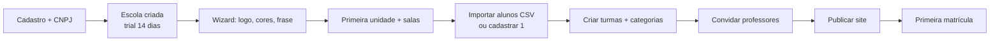
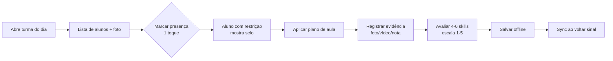
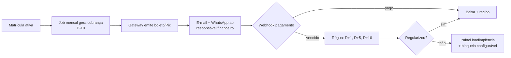

# 03 — Personas e jornadas

## 1. Personas

### P1. Ruy — dono da escola (Admin)
- 38 anos, ex-jogador, 2 unidades, 210 alunos, 9 professores.
- Não é técnico. Usa celular para tudo. Sensível a preço e a "mais um sistema".
- **Dor:** não sabe quanto realmente sobra no mês; não sabe quem está devendo sem abrir planilha.
- **Sucesso:** abrir o app e ver caixa, inadimplência e ocupação de turma em 30 segundos.

### P2. Fabiana — coordenadora pedagógica
- 31 anos, organiza currículo, cobra plano de aula e avaliações.
- **Dor:** professor entrega avaliação em papel, some, e ela não consegue comparar evolução.
- **Sucesso:** ver a evolução da turma e identificar quem precisa de reforço.

### P3. Diego — professor de campo
- 24 anos, 6 turmas, trabalha em 2 escolas, celular Android intermediário, 4G ruim.
- **Dor:** chamada em papel molhado, avaliação "de cabeça", esquece quem faltou.
- **Sucesso:** registrar chamada e 5 avaliações em menos de 2 minutos, offline.

### P4. Patrícia — mãe/responsável
- 36 anos, dois filhos na escola, paga boleto, quer saber se o filho evoluiu.
- **Dor:** boleto perdido no e-mail, grupo de WhatsApp com 200 mensagens, não sabe o que o filho aprendeu.
- **Sucesso:** boleto no dia certo, card do filho, autorização de viagem em 1 clique.

### P5. Théo — aluno de 10 anos
- Não é usuário do sistema. Vê o card no celular da mãe e mostra para os amigos.
- **Sucesso:** sentir que evoluiu e que o esforço é reconhecido.

### P6. Bruna — financeiro da escola
- 29 anos, concilia boletos, cobra inadimplentes, paga fornecedores.
- **Dor:** baixa manual, boleto pago que não aparece, cobrança constrangedora.
- **Sucesso:** conciliação automática e régua de cobrança que não queima a relação.

### P7. Suporte NextGen (interno)
- Precisa impersonar uma escola para resolver ticket **sem** ver dado sensível.
- **Sucesso:** acesso suportado, auditado, com escopo e expiração.

## 2. Jornadas principais

### J1. Onboarding da escola (30 minutos, meta)

**Regra:** a escola só é considerada "ativada" quando publica o site **e** tem 10 alunos
com responsável confirmado.

### J2. Matrícula (presencial)

1. Secretaria busca o aluno por nome/CPF do responsável.
2. Se novo: nome, nascimento, gênero opcional, foto opcional, responsável (nome, CPF, e-mail, telefone).
3. Sistema calcula categoria pela data de nascimento e temporada.
4. Escolhe unidade, turma (com vagas), plano e dia de vencimento (5, 10, 15, 20).
5. Registra documentos: certidão, documento do responsável, atestado médico (validade).
6. Envia convite ao responsável; matrícula fica `pending_guardian`.
7. Responsável confirma, aceita termos e recebe o primeiro boleto/Pix.

**Exceções:** turma lotada (lista de espera), aluno sem CPF (matrícula manual), responsável
sem e-mail (convite por SMS/WhatsApp com link), aluno bolsista (valor zero).

### J3. Treino (app do professor)

**Requisito:** tudo funciona offline; conflito resolvido por `last-write-wins` com
`updated_at` do dispositivo + log de conflito.

### J4. Ciclo de avaliação (trimestral)

1. Coordenação abre o ciclo (`evaluation_cycle`) para a temporada.
2. Professor avalia skills do período com nota + evidência.
3. Coordenação revisa e aprova (workflow de 2 etapas).
4. Sistema calcula evolução (delta vs ciclo anterior).
5. Responsável recebe resumo no portal; card é atualizado.
6. Aluno recebe badges (sem ranking, sem loot box).

### J5. Cobrança

### J6. Ocorrência de saúde/lesão em treino

1. Professor registra ocorrência (tipo, gravidade, descrição, foto opcional).
2. Sistema notifica responsável e coordenação **imediatamente** se gravidade alta.
3. Coordenação anexa atendimento e define afastamento.
4. Aluno aparece como "afastado" na chamada até liberação médica.
5. Evento entra no histórico de saúde (visibilidade restrita).

### J7. Maioridade

Ver [`02-menores-lgpd.md`](02-menores-lgpd.md#64-maioridade).

## 3. Mapa de permissões (RBAC)

| Capacidade | Admin escola | Coordenação | Professor | Financeiro | Responsável | Aluno 16+ | Suporte NextGen |
|---|---|---|---|---|---|---|---|
| Editar escola/site | ✅ | ⚠️ | ❌ | ❌ | ❌ | ❌ | ❌ |
| Criar/editar aluno | ✅ | ✅ | ❌ | ❌ | ⚠️ próprio | ⚠️ próprio | ❌ |
| Ver dados cadastrais | ✅ | ✅ | ⚠️ turma | ⚠️ cobrança | ⚠️ próprio | ⚠️ próprio | ❌ |
| Ver anamnese completa | ✅ | ✅ | ❌ | ❌ | ⚠️ próprio | ⚠️ próprio | ❌ |
| Ver kit de emergência | ✅ | ✅ | ✅ turma | ❌ | ⚠️ próprio | ⚠️ próprio | ❌ |
| Criar turma/horário | ✅ | ✅ | ❌ | ❌ | ❌ | ❌ | ❌ |
| Criar conteúdo | ✅ | ✅ | ✅ próprias | ❌ | ❌ | ❌ | ❌ |
| Avaliar aluno | ✅ | ✅ | ✅ turma | ❌ | ❌ | ❌ | ❌ |
| Lançar chamada | ✅ | ✅ | ✅ turma | ❌ | ❌ | ❌ | ❌ |
| Ver financeiro | ✅ | ❌ | ❌ | ✅ | ⚠️ próprio | ❌ | ❌ |
| Emitir cobrança | ✅ | ❌ | ❌ | ✅ | ❌ | ❌ | ❌ |
| Publicar card do aluno | ✅ | ✅ | ❌ | ❌ | ⚠️ próprio | ❌ | ❌ |
| Impersonar escola | ❌ | ❌ | ❌ | ❌ | ❌ | ❌ | ✅ auditado |

⚠️ = somente com vínculo e dentro do escopo.

## 4. Regras transversais de UX

1. **Toda tela tem um "estado vazio" que ensina** — o admin nunca vê uma tabela em branco sem CTA.
2. **Português do dia a dia**, não jurídiquês. "Quem pode buscar seu filho na escola?" em vez
   de "pessoas autorizadas para retirada".
3. **Mobile-first para professor e responsável**; desktop para backoffice.
4. **Nunca mais de 3 toques** para chamada, pagamento e aprovação.
5. **Confirmação destrutiva** com digitação do nome da escola em ações irreversíveis.
6. **Acessibilidade**: contraste AA, fontes 16px+, área de toque 44px, funciona com uma mão.

## 5. Entrada no produto (site público)

Três portas, uma autenticação.

| Rota | Público | Papel |
|---|---|---|
| `/` | todos | Diz em três linhas o que é e para quem. Duas portas e um "Saiba mais". |
| `/como-funciona` | quem quer detalhe | Módulos, pilares e o modelo de menor de idade. |
| `/escola` | administrador | Entrar na escola existente ou pedir cadastro. |
| `/escola/solicitar` | escola nova | Formulário que grava um pedido de cadastro (`school_leads`). |
| `/login` | todos os usuários | Um mecanismo só: e-mail com link. |

**Por que a escola não se cadastra sozinha.** A escola é a controladora dos dados dos
alunos. Criar uma escola é criar um controlador: exige contrato, definição de quem acessa o
quê e base legal para tratar dado de menor. O formulário registra o pedido; a ativação é
feita por quem opera a plataforma. Isso também evita escola fantasma consumindo tenant e
nome de endereço público.

**Por que o login é um só.** Responsável, professor e administração entram pelo mesmo lugar.
Duas telas de login seriam duas chances de divergir validação, origem confiável e mensagem
de erro. O que muda é a porta de entrada e o que a pessoa encontra depois do login.

**Aluno não tem porta.** Menor de 16 não tem conta: o acesso é do responsável legal. Chamar
a porta de "aluno/responsável" prometeria um login que o produto não oferece e não deve
oferecer.
