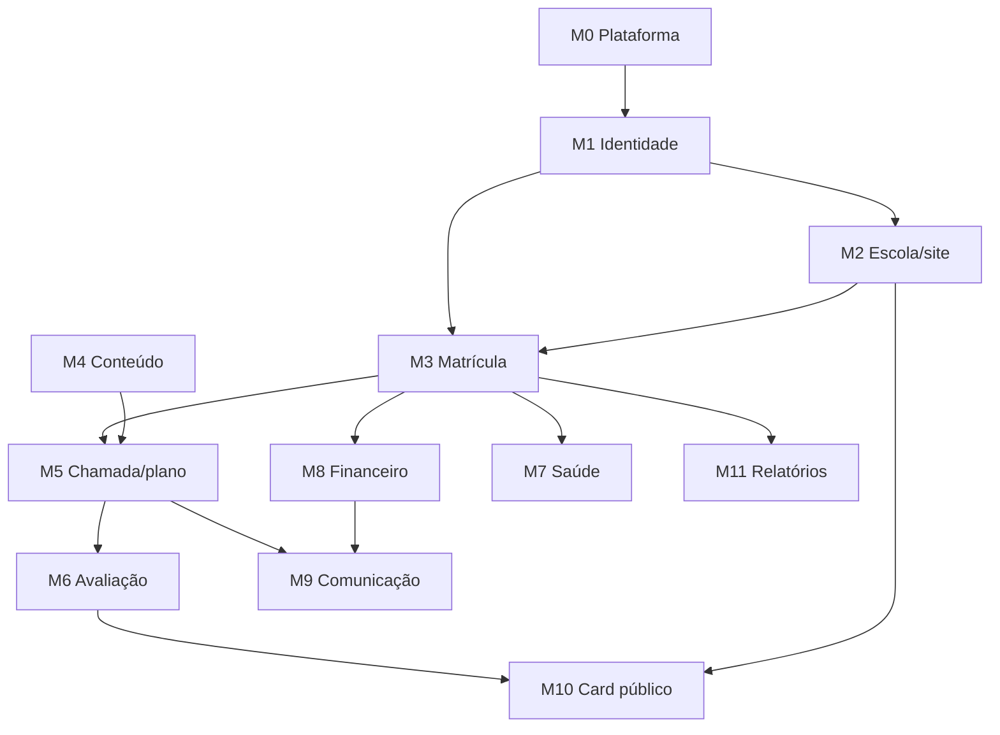

# 04 — Módulos e regras de negócio

Legenda de prioridade: **MVP** (v1), **v1.1**, **v2**, **futuro**.

---

## M0. Plataforma e multi-tenancy — MVP

**Objetivo:** isolar escolas com segurança e permitir operação comercial do SaaS.

- Cadastro de escola (CNPJ, responsável, trial de 14 dias)
- Plano de assinatura, limite de alunos e features por plano
- Backoffice NextGen: escolas, faturas do SaaS, uso, suporte, feature flags
- Impersonação auditada com escopo e expiração
- Onboarding wizard e checklist de ativação

**Regras**
- Todo registro de domínio carrega `school_id`; RLS obrigatória.
- `school_id` **nunca** vem do payload — vem da sessão/tenant resolvido.
- Uma escola pode ter N unidades; o plano limita unidades.

---

## M1. Identidade, vínculo e consentimento — MVP

**Objetivo:** garantir que o aluno certo esteja sob o responsável certo, com provas.

- Conta de usuário (admin, coordenação, professor, financeiro, suporte)
- Convite por e-mail com expiração → definição de senha; login do dia a dia por e-mail e
  senha (Google na v2)
- 2FA opcional para admins; obrigatório para suporte NextGen
- Vínculo `student_guardian` com grau (pai, mãe, avô, tutor) e flags
  (`legal`, `financial`, `pickup_authorized`)
- Verificação documental e de e-mail (ver doc 02)
- Consentimentos versionados + portal de privacidade
- Log de auditoria de leitura e escrita

**Regras**
- Um aluno tem **exatamente um** responsável legal principal e pode ter vários
  responsáveis financeiros.
- Sem responsável confirmado, o aluno não acessa conteúdo e não gera cobrança.
- Revogação de consentimento é imediata e auditada.
- Exclusão de conta de responsável com aluno ativo exige transferência de vínculo.

---

## M2. Escola, unidades, salas e identidade visual — MVP

**Objetivo:** dar à escola uma presença própria, sem depender de agência.

- Dados da escola: razão social, CNPJ, nome fantasia, descrição, contatos
- Identidade: logo, favicon, paleta (primária/secundária), tipografia, frase de efeito
- Unidades: nome, endereço, CEP, geolocalização opcional, horários
- Salas/campos: nome, tipo (campo, quadra, sala), capacidade, cobertura
- Domínio: subdomínio `escola.nextgen.app` (v1) e domínio próprio (v2)
- Publicação do site com preview e rollback

**Regras**
- Trocar paleta não pode quebrar contraste AA (validar e sugerir correção).
- Endereço é da unidade, **não** da sala.
- Excluir unidade com turma ativa é bloqueado (arquivar em vez de excluir).

---

## M3. Alunos, turmas e matrícula — MVP

**Objetivo:** o coração operacional. Matricular sem planilha.

### Aluno
- Nome, apelido, nascimento, gênero (opcional), foto (opcional), escola anterior
- Contatos de emergência, pessoas autorizadas a retirar (com foto e parentesco)
- Documentos com validade (atestado médico, autorização)
- Histórico: turmas, avaliações, ocorrências, financeiro

### Categorias
- Turmas com nome livre por escola ("Sub-8 — Ter/Qui 17h", "Iniciação", "Feminino Sub-13")
- Sem categoria nem temporada: idade é derivada da data de nascimento
- Regra configurável para ano civil vs ano esportivo
- Troca de turma no fim do ciclo é ação da secretaria, com histórico

### Turmas
- Nome livre, unidade, sala, dias/horários, capacidade, professor(es)
- Lista de espera quando lotada
- Aula experimental com aluno `trial` que não gera cobrança
- Reposição de aula (falta justificada → crédito de reposição)

### Matrícula
- Vínculo aluno ↔ turma ↔ plano, com vigência
- Status: `draft → pending_guardian → active → suspended → cancelled → completed`
- Mudança de turma no meio do ciclo com histórico
- Trancamento e cancelamento com regra de cobrança proporcional

**Regras**
- Um aluno não pode ter duas matrículas ativas na mesma turma no mesmo período.
- Categoria incompatível com a idade exige override com justificativa e auditoria.
- Capacidade da turma é validada no servidor, com lock para evitar overbooking.
- Cancelamento **não apaga** histórico financeiro nem pedagógico.

---

## M4. Pedagogia: matérias, capítulos e conteúdos — v1.1

**Objetivo:** transformar o conhecimento da escola em trilha reutilizável.

- Matéria (ex.: Fundamentos Técnicos, Tática, Físico, Mental)
- Capítulo dentro da matéria, com ordem e pré-requisitos opcionais
- Conteúdo: vídeo, áudio, imagem, PDF, texto rico, quiz
- Publicação por turma; agendamento
- Progresso do aluno por conteúdo (para 12+; para criança, progresso visível ao responsável)
- Versionamento de conteúdo e biblioteca compartilhada entre unidades

**Melhorias sugeridas**
- Vídeo e áudio no Vercel Blob privado, entregue por URL assinada de 5–15 min (sem link permanente, sem download fácil).
- Compressão no cliente antes do upload: clipe de avaliação até ~100 MB, 720p.
- Player com marcação de "assistido" por tempo, não por clique.
- Quiz curto ao final para fixação (sem nota pública).
- Download offline de PDF/áudio no app do professor.

**Regras**
- Conteúdo só aparece para alunos com matrícula ativa e responsável confirmado.
- Material com imagem de aluno exige consentimento de imagem interna.
- Excluir conteúdo com progresso registrado = arquivar, não deletar.

---

## M5. Plano de aula, chamada e diário — MVP

**Objetivo:** o professor resolve tudo em campo, offline.

- Plano de aula com objetivo, aquecimento, fundamentos, jogo, volta à calma
- Templates por duração (45/60/90 min)
- Clonar plano de outra turma/semana
- Chamada com 1 toque: presente, falta, atraso, justificada
- Diário: observações da aula, fotos, vídeos
- Reposição e crédito de aula
- Relatório de aulas dadas por professor (base para pagamento futuro)

**Regras**
- Chamada só pode ser lançada por professor vinculado à turma (ou coordenação).
- Janela de edição: 7 dias (configurável); depois, só coordenação com justificativa.
- Sync offline com fila local e resolução de conflito registrada.
- Frequência alimenta o bloqueio de "aluno sem presença mínima" (configurável).

---

## M6. Avaliação de habilidades e card — v1.1

**Objetivo:** medir evolução de forma justa, com evidência e sem exposição.

- Modelo de skills por escola (default: 4 pilares, 12-16 atributos)
- Escala 1–5 com descritores por nível (rubrica)
- Ciclos de avaliação (trimestral), com rascunho → enviado → aprovado
- Evidência: nota textual, foto, vídeo
- Cálculo de evolução (delta, tendência, consistência)
- Card visual (público opt-in e privado)
- Badges e conquistas (sem ranking, sem loot box)

Detalhes em [`08-avaliacao-e-card.md`](08-avaliacao-e-card.md).

**Regras**
- Só o professor da turma avalia; coordenação aprova.
- Avaliação aprovada é imutável (correção gera nova versão).
- Comportamento **nunca** aparece em card público.
- Criança < 12 não vê nota numérica de si mesma no app (vê barras de progresso);
  o responsável vê o detalhamento.

---

## M7. Saúde, anamnese e ocorrências — MVP (kit) / v1.1 (completa)

**Objetivo:** proteger a criança e a escola.

- Kit de emergência (alergias, medicação, condições, contato)
- Anamnese inicial e periódica com perguntas condicionais
- Atestado médico com validade e alerta
- Ocorrências: lesão, mal-estar, comportamento, incidente disciplinar
- Afastamento e liberação médica
- Termo de autorização de viagem/competição
- Registro de medicação administrada (com responsável)

**Regras**
- Ver [`02-menores-lgpd.md`](02-menores-lgpd.md#7-dados-de-saúde-o-ponto-mais-sensível).
- Ocorrência de gravidade alta dispara notificação imediata ao responsável.
- Professor vê apenas kit de emergência e ocorrências da própria turma.
- Nenhum dado de saúde em e-mail/push; notificação diz apenas "há uma atualização de saúde".

---

## M8. Financeiro — MVP (cobrança) / v1.1 (gestão)

**Objetivo:** previsibilidade de caixa e menos inadimplência.

- Planos de mensalidade (valor, periodicidade, matrícula, material)
- Descontos, bolsas, promoções, plano família
- Cobrança por boleto, Pix e cartão recorrente
- Dia de vencimento escolhido na matrícula
- Geração mensal automática, pro-rata no primeiro mês
- Baixa automática por webhook + conciliação manual
- Régua de cobrança (e-mail/WhatsApp) configurável
- Despesas por categoria, centro de custo e fornecedor
- Painel: recebido, a receber, vencido, despesas, saldo, inadimplência, aging
- Recibos e relatórios exportáveis

Detalhes em [`07-financeiro.md`](07-financeiro.md).

**Regras**
- O **pagador é o responsável financeiro**, nunca o aluno.
- A conta de recebimento é da escola (gateway próprio ou subconta).
- Nenhuma cobrança é gerada para aluno `trial`, `pending_guardian` ou bolsista 100%.
- Alterar plano no meio do ciclo gera ajuste proporcional, não nova cobrança cheia.
- Negativação só após régua e nunca em nome do menor.

---

## M9. Comunicação e notificações — v1.1

**Objetivo:** tirar a escola do grupo de WhatsApp, sem perder alcance.

- Mural/avisos por escola, unidade, turma ou aluno
- Notificações: e-mail (transacional), push, WhatsApp (template aprovado)
- Preferências por canal e por tipo
- Confirmação de leitura em avisos críticos
- Modelos de mensagem com variáveis (nome, turma, vencimento, valor)
- **Sem chat** entre adultos e menores

**Regras**
- Todo envio passa por `notification_log` (canal, template, status, custo).
- WhatsApp só com opt-in do responsável, respeitando janela e template aprovado.
- Aviso de cobrança vai só para o responsável financeiro.
- Falha de envio entra em fila com retry e alerta no painel.

---

## M10. Site público da escola e card público — v1.1

**Objetivo:** aquisição e prova social, com consentimento.

- Página pública da escola: hero, sobre, unidades, equipe, galeria, depoimentos
- Formulário de aula experimental (lead) com LGPD e captcha
- Botão de WhatsApp
- SEO: título, descrição, OG image, sitemap, JSON-LD (`SportsActivityLocation`)
- Domínio próprio (v2)
- Card público do aluno opt-in

**Regras**
- Publicar exige pelo menos: logo, frase, 1 unidade, 1 turma ativa.
- Depoimento de responsável exige consentimento específico e pode ser revogado.
- Fotos de alunos no site seguem o consentimento de imagem pública.
- Card do aluno: ver regras do doc 02 §8.

---

## M11. Relatórios, auditoria e dados — v1.1

- Relatórios: frequência, evolução por turma, ocupação, inadimplência, DRE simplificado
- Exportações CSV/PDF assíncronas por e-mail
- Auditoria: log append-only com ator, ação, entidade, antes/depois, IP
- Exportação completa da escola (portabilidade e saída sem lock-in)
- Métricas de produto (uso por módulo, adoção por professor)

**Regras**
- Exportação com dado sensível exige role elevada e gera evento de auditoria.
- Log nunca contém dado de saúde nem senha/token.
- Retenção de log: 5 anos (configurável por contrato).

---

## Matriz de dependências

## Melhorias de escopo sugeridas (fora do pedido original)

| # | Melhoria | Por quê | Prioridade |
|---|---|---|---|
| 1 | Unidade ≠ sala | evita retrabalho multi-sede | MVP |
| 2 | Responsável legal ≠ financeiro | divórcio, avô paga, empresa paga | MVP |
| 3 | Pessoas autorizadas a retirar | segurança da criança | MVP |
| 4 | Aula experimental + lista de espera | conversão comercial | v1.1 |
| 5 | Reposição de aula | dor real de escola | v1.1 |
| 6 | Atestado médico com validade | risco jurídico e de saúde | MVP |
| 7 | Ocorrência/lesão em treino | proteção da escola | MVP |
| 8 | Offline-first no app do professor | campo sem sinal | MVP |
| 9 | Portal do responsável | reduz ligação na secretaria | MVP |
| 10 | Card de evolução compartilhável | aquisição orgânica | v1.1 |
| 11 | Backoffice NextGen + feature flags | operação do SaaS | MVP |
| 12 | Exportação total da escola | confiança e LGPD | v1.1 |
| 13 | Relatório de aulas por professor | base para repasse | v1.1 |
| 14 | WhatsApp transacional | canal real do Brasil | v1.1 |
| 15 | Domínio próprio da escola | plano Clube | v2 |
