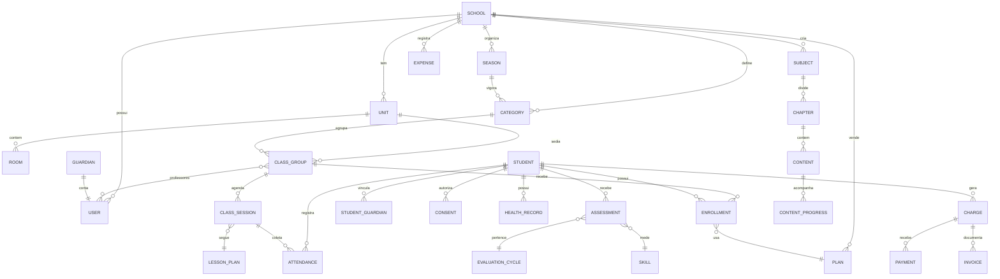

# 05 — Modelo de dados

## 1. Princípios

1. **Multi-tenant por coluna:** toda tabela de domínio tem `school_id`, com RLS.
2. **Soft delete** (`deleted_at`) em entidades com histórico; exclusão física só via job de retenção.
3. **Append-only** em consentimentos, auditoria e avaliações aprovadas.
4. **Dinheiro em centavos** (`integer`), nunca `float`.
5. **Datas com fuso** (`timestamptz`); datas civis (`date`) para nascimento e vencimento.
6. **IDs UUID v7** (ordenáveis por tempo) para melhor localidade de índice.
7. **Nunca armazenar CPF/documento em claro** quando não for indispensável; se for, criptografar
   e guardar apenas os últimos 4 dígitos para exibição.

## 2. ERD macro



## 3. Tabelas principais

### 3.1 Tenant e identidade

| Tabela | Campos-chave | Notas |
|---|---|---|
| `schools` | `id`, `slug`, `legal_name`, `cnpj`, `status`, `plan_code`, `trial_ends_at`, `settings jsonb` | `slug` único → subdomínio |
| `units` | `id`, `school_id`, `name`, `address`, `city`, `state`, `zip`, `timezone` | endereço mora aqui |
| `rooms` | `id`, `school_id`, `unit_id`, `name`, `kind`, `capacity` | `kind`: field/court/classroom |
| `users` | `id`, `email`, `name`, `phone`, `password_hash`, `status`, `locale` | login global |
| `memberships` | `id`, `school_id`, `user_id`, `role`, `status` | N:N usuário↔escola com papel |
| `guardians` | `id`, `school_id`, `user_id`, `cpf_hash`, `cpf_last4`, `relation_default` | conta do adulto |
| `students` | `id`, `school_id`, `full_name`, `nickname`, `birth_date`, `gender`, `photo_key`, `status`, `notes_internal` | **sem e-mail, sem senha** |
| `student_guardians` | `id`, `student_id`, `guardian_id`, `relation`, `is_legal`, `is_financial`, `is_pickup_authorized`, `verified_at`, `verification_method` | vínculo |
| `pickup_authorized_people` | `id`, `student_id`, `name`, `relation`, `document_last4`, `photo_key`, `active` | segurança |

**Índices:** `students (school_id, lower(full_name))` com `pg_trgm`; `students (school_id, birth_date)`.

### 3.2 Temporada, categoria e turma

| Tabela | Campos-chave | Notas |
|---|---|---|
| `seasons` | `id`, `school_id`, `name`, `starts_on`, `ends_on`, `status` | ex.: "2027" |
| `categories` | `id`, `school_id`, `season_id`, `name`, `birth_year_from`, `birth_year_to`, `age_min`, `age_max`, `sort_order` | Sub-8… |
| `class_groups` | `id`, `school_id`, `unit_id`, `room_id`, `season_id`, `category_id`, `name`, `weekdays int[]`, `start_time`, `end_time`, `capacity`, `status` | horário simples no MVP |
| `class_group_teachers` | `class_group_id`, `user_id`, `role`, `from_date`, `to_date` | histórico de professor |
| `enrollments` | `id`, `school_id`, `student_id`, `class_group_id`, `plan_id`, `status`, `starts_on`, `ends_on`, `due_day`, `discount_cents`, `waitlist_position` | matrícula |

**Constraint crítica:**

```sql
-- impede duas matrículas ativas do mesmo aluno na mesma turma
create unique index enrollments_active_unique
  on enrollments (student_id, class_group_id)
  where status = 'active' and deleted_at is null;
```

**Regra de categoria:** no cadastro, o sistema deriva `category_id` da temporada ativa e
bloqueia se a idade não couber, exigindo `override_reason` + `approved_by`.

### 3.3 Pedagogia

| Tabela | Campos-chave |
|---|---|
| `subjects` | `id`, `school_id`, `name`, `description`, `color`, `order` |
| `chapters` | `id`, `subject_id`, `title`, `description`, `order`, `published_at` |
| `contents` | `id`, `chapter_id`, `kind` (`video`/`audio`/`image`/`pdf`/`text`/`quiz`), `title`, `storage_key`, `duration_s`, `body`, `published_at`, `visibility` |
| `content_assignments` | `content_id`, `class_group_id`, `available_from`, `available_until` |
| `content_progress` | `student_id`, `content_id`, `seconds_watched`, `completed_at` |
| `lesson_plans` | `id`, `school_id`, `author_user_id`, `title`, `category_id`, `duration_min`, `blocks jsonb`, `is_template` |
| `class_sessions` | `id`, `class_group_id`, `lesson_plan_id`, `starts_at`, `ends_at`, `room_id`, `status`, `notes` |
| `attendance` | `id`, `class_session_id`, `student_id`, `status` (`present`/`absent`/`late`/`excused`), `recorded_by`, `recorded_at`, `offline_created_at` |

### 3.4 Avaliação

| Tabela | Campos-chave |
|---|---|
| `skill_frameworks` | `id`, `school_id`, `name`, `is_default` |
| `skills` | `id`, `framework_id`, `pillar` (`technical`/`physical`/`tactical`/`behavioral`), `code`, `name`, `weight`, `order`, `is_public` |
| `evaluation_cycles` | `id`, `school_id`, `season_id`, `name`, `starts_on`, `ends_on`, `status` |
| `assessments` | `id`, `school_id`, `student_id`, `cycle_id`, `evaluator_user_id`, `status` (`draft`/`submitted`/`approved`), `overall_score`, `approved_by`, `approved_at`, `version` |
| `assessment_scores` | `id`, `assessment_id`, `skill_id`, `score` (1–5), `note`, `evidence_key` |
| `badges` | `id`, `school_id`, `code`, `name`, `description`, `icon`, `criteria jsonb` |
| `student_badges` | `student_id`, `badge_id`, `awarded_at`, `awarded_by` |

Imutabilidade:

```sql
create or replace function prevent_assessment_mutation() returns trigger as $$
begin
  if old.status = 'approved' then
    raise exception 'avaliação aprovada é imutável; crie nova versão';
  end if;
  return new;
end $$ language plpgsql;
```

### 3.5 Saúde

| Tabela | Campos-chave | Proteção |
|---|---|---|
| `health_profiles` | `id`, `student_id`, `blood_type`, `allergies_enc`, `medications_enc`, `conditions_enc`, `emergency_contact_name`, `emergency_contact_phone_enc`, `updated_at` | colunas `*_enc` criptografadas |
| `anamnesis_forms` | `id`, `school_id`, `version`, `schema jsonb` | versionado |
| `anamnesis_responses` | `id`, `student_id`, `form_id`, `answers_enc`, `submitted_by`, `submitted_at`, `next_due_on` | dado sensível |
| `medical_certificates` | `id`, `student_id`, `issued_on`, `expires_on`, `file_key`, `verified_by` | validade |
| `health_incidents` | `id`, `student_id`, `class_session_id`, `severity`, `kind`, `description`, `reported_by`, `guardian_notified_at`, `restriction_until` | ocorrências |

**Regra de acesso:** `health_profiles` tem dois níveis lógicos:
`emergency_kit` (visível ao professor) e `clinical` (coordenação/DPO).

### 3.6 Financeiro

| Tabela | Campos-chave | Notas |
|---|---|---|
| `plans` | `id`, `school_id`, `name`, `kind` (`monthly`/`material`/`enrollment_fee`), `amount_cents`, `cycle`, `active` | catálogo |
| `charges` | `id`, `school_id`, `student_id`, `enrollment_id`, `payer_guardian_id`, `description`, `amount_cents`, `discount_cents`, `due_date`, `status`, `gateway`, `external_id`, `barcode`, `pix_copy_paste`, `paid_at` | conta a receber |
| `payments` | `id`, `charge_id`, `amount_cents`, `method`, `paid_at`, `gateway_payment_id`, `raw jsonb`, `source` (`webhook`/`manual`) | baixa |
| `invoices` | `id`, `school_id`, `number`, `issued_at`, `pdf_key`, `amount_cents` | recibo/NF futura |
| `expenses` | `id`, `school_id`, `unit_id`, `category`, `supplier`, `description`, `amount_cents`, `due_date`, `paid_at`, `receipt_key`, `recurring_rule jsonb` | despesas |
| `billing_settings` | `school_id`, `gateway`, `credentials_enc`, `due_days int[]`, `late_fee_pct`, `interest_pct_month`, `dunning_steps jsonb` | config |
| `webhook_events` | `id`, `gateway`, `external_id`, `payload`, `processed_at`, `status` | idempotência |

**Regras**
- `charges.payer_guardian_id` **nunca** aponta para `student`.
- `charges.status`: `draft`, `open`, `paid`, `overdue`, `cancelled`, `refunded`, `partial`.
- `webhook_events.external_id` é único → idempotência garantida no banco.
- Estorno cria `payments` negativos; não apaga o pagamento original.

### 3.7 Consentimento, auditoria e plataforma

| Tabela | Campos-chave |
|---|---|
| `consent_purposes` / `consent_terms` / `consents` | ver doc 02 §4 |
| `audit_logs` | `id`, `school_id`, `actor_user_id`, `actor_role`, `action`, `entity`, `entity_id`, `before jsonb`, `after jsonb`, `ip`, `user_agent`, `created_at` |
| `notification_log` | `id`, `school_id`, `channel`, `template`, `recipient_user_id`, `status`, `provider_id`, `cost_cents`, `sent_at` |
| `subscriptions` | `id`, `school_id`, `plan_code`, `status`, `seats`, `current_period_end`, `gateway_customer_id` |
| `feature_flags` | `id`, `school_id`, `flag`, `enabled`, `payload jsonb` |
| `export_jobs` | `id`, `school_id`, `requested_by`, `kind`, `status`, `file_key`, `expires_at` |

## 4. Row Level Security (obrigatório)

```sql
alter table students enable row level security;

create policy students_tenant_isolation on students
  using (school_id = current_setting('app.school_id')::uuid);
```

- A aplicação define `app.school_id` por transação a partir da sessão (nunca do body).
- Usuário com `role = platform_support` recebe `app.school_id` apenas durante impersonação
  autorizada, com expiração e registro em `audit_logs`.
- Teste automatizado: para cada tabela com `school_id`, tentar `select` com tenant errado
  deve retornar 0 linhas.

## 5. Índices e performance

- `charges (school_id, status, due_date)` — painel e régua.
- `attendance (class_session_id, student_id)` único.
- `assessments (student_id, cycle_id)` único por versão ativa.
- `audit_logs (school_id, created_at desc)` — particionar por mês quando crescer.
- `students` com busca textual (`pg_trgm`) em nome e apelido.
- `notification_log (status, created_at)` — fila e reprocessamento.

## 6. Migrações e versionamento

- Prisma Migrate; migração sempre **expansiva** (adiciona, não remove) em produção.
- Remoção de coluna só após duas releases sem uso.
- Seed de desenvolvimento com 1 escola, 30 alunos, 3 turmas e dados fictícios.
- Nunca rodar `db push` em produção.
