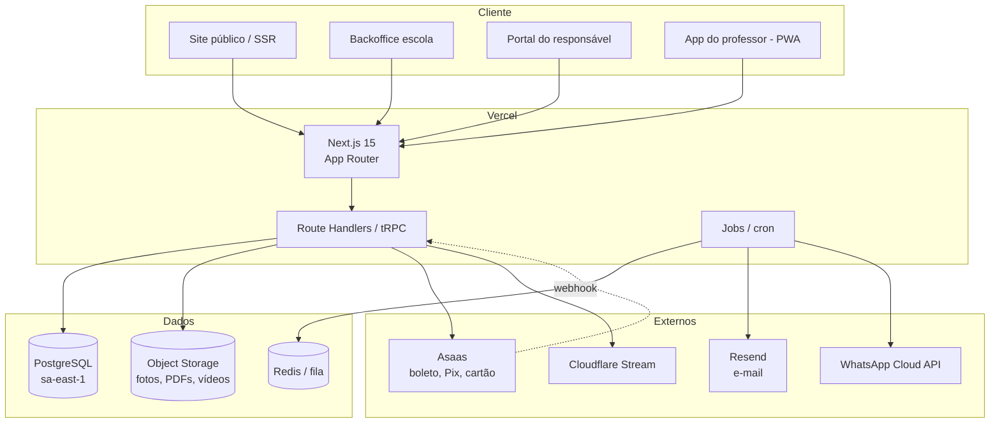

# 06 — Arquitetura técnica

## 1. Decisão de arquitetura

**Monolito modular** com Next.js full-stack + PostgreSQL. Não é microserviço, não é
multi-repo. O objetivo é entregar rápido, com um deploy e um banco, sem sacrificar
isolamento entre escolas.



## 2. Stack recomendada

| Camada | Escolha | Por quê | Alternativa |
|---|---|---|---|
| Framework | **Next.js 15 + TypeScript** | SSR para o site público (SEO), um código para backoffice e portal | Remix, Astro + API separada |
| UI | **Tailwind + shadcn/ui** | velocidade, consistência, acessibilidade | Chakra, MUI |
| API | **tRPC** (interno) + Route Handlers (público/webhooks) | tipagem ponta a ponta | REST, GraphQL |
| Banco | **PostgreSQL 16** | RLS, JSONB, transações, maturidade | MySQL |
| ORM | **Prisma** | produtividade e migrações | Drizzle |
| Auth | **Better Auth** | organizações, convites, passkeys, 2FA, sessão robusta | Auth.js, Clerk |
| Jobs | **Inngest** | retry, cron, idempotência, observabilidade sem operar worker | Trigger.dev, BullMQ |
| Arquivos | **Cloudflare R2** (ou S3) | custo baixo, egress barato, URLs assinadas | S3, Backblaze |
| Vídeo | **Cloudflare Stream** | transcodificação, HLS, link assinado | Mux, Vimeo |
| Pagamento | **Asaas** | Pix + boleto + cartão, webhooks, subconta | Iugu, Pagar.me |
| E-mail | **Resend** | templates React, deliverability | Postmark, SES |
| WhatsApp | **Meta Cloud API** via BSP | canal real do Brasil | Twilio, Z-API |
| Infra | **Vercel + Neon** (`sa-east-1`) | deploy simples, banco serverless com branch | Railway, Fly.io |
| Observabilidade | **Sentry + Axiom + Better Stack** | erro, log, uptime | Datadog |
| Testes | **Vitest + Playwright** | unitário e e2e | Jest, Cypress |

## 3. Estrutura do monorepo

```
nextgen/
├─ apps/
│  ├─ web/                 # Next.js: site público, backoffice, portal (multi-tenant por host)
│  └─ worker/              # opcional: consumidor de fila dedicado (se sair do Inngest)
├─ packages/
│  ├─ db/                  # schema Prisma, migrations, seeds, políticas RLS
│  ├─ core/                # regras de negócio puras (dinheiro, categoria, avaliação)
│  ├─ ui/                  # design system (shadcn + tokens)
│  ├─ auth/                # configuração de auth, RBAC, guards
│  └─ integrations/        # asaas, resend, whatsapp, storage
├─ docs/
├─ turbo.json
└─ package.json
```

**Regras**
- `apps/web` não contém regra de negócio: chama `packages/core`.
- `packages/core` é puro TypeScript, testável sem banco.
- Integrações externas só em `packages/integrations`, atrás de interface.
- Um único schema Prisma; sem `schema` por tenant.

## 4. Multi-tenancy

**Modelo:** banco único, schema único, coluna `school_id` + RLS. Adequado para milhares de
escolas pequenas, com custo marginal baixo.

**Resolução do tenant (ordem):**
1. domínio próprio (`escola.com.br`) ou subdomínio (`escola.nextgen.app`) → `school.slug`;
2. sessão autenticada → `membership.school_id`;
3. nunca pelo `school_id` do payload.

**Middleware:**
- valida host, resolve tenant, injeta `schoolId` em `headers` internos;
- bloqueia host desconhecido;
- para rotas autenticadas, valida `membership` ativa.

**Banco:**
- conexão com `SET LOCAL app.school_id = '...'` por transação;
- RLS em todas as tabelas de domínio;
- teste de isolamento em CI (ver doc 05 §4).

**Quando migrar para schema/banco por tenant:** se aparecer requisito de cliente enterprise
com isolamento físico ou residência de dados dedicada. O código já deve usar repositórios por
tenant para permitir essa evolução.

## 5. Autenticação e autorização

- Sessões em cookie `HttpOnly`, `Secure`, `SameSite=Lax`.
- Login: magic link (padrão), senha opcional, Google (opcional), passkey (v2).
- 2FA obrigatório para `admin` e `platform_support`.
- RBAC por `membership.role` + escopo: `school`, `unit`, `class_group`, `self`.
- Guards declarativos:

```ts
export const can = (actor: Actor, action: Action, resource?: Resource) => boolean;
```

- Toda mutação registra `audit_logs`.
- Impersonação: token de curta duração, banner visível, `audit_log` e proibição de ver saúde.

## 6. App do professor: offline-first

O campo não tem 4G confiável. Estratégia:

1. **PWA** com service worker + IndexedDB.
2. Pré-carga ao abrir a turma: alunos, fotos (thumbs), plano de aula, kit de emergência.
3. Escritas vão para uma fila local (`outbox`) com `client_generated_id` (UUID v7).
4. Sync em background quando online; servidor trata idempotência pelo `client_generated_id`.
5. Conflito: versão do servidor vence em campos administrativos; em chamada/avaliação,
   vence a última escrita do professor com log de divergência.
6. Indicador explícito: "3 registros pendentes de envio".
7. Nunca apagar dados locais antes de confirmação do servidor.

**Limite:** fotos/vídeos grandes ficam em fila separada, com compressão no dispositivo.

## 7. Armazenamento de arquivos

- Upload direto do cliente para o storage via URL pré-assinada (não passa pelo Next).
- Bucket privado; leitura por URL assinada com expiração de 5–15 min.
- Estrutura de chave: `school/{school_id}/student/{student_id}/{uuid}.jpg`.
- Nome original nunca é usado como chave (evita path traversal e vazamento de nome).
- Varredura de MIME e tamanho; imagem reprocessada (strip EXIF, inclusive geolocalização).
- **EXIF é removido sempre** — foto de criança não pode carregar GPS.
- Vídeo de avaliação: upload → transcodificação → só disponível após processamento.
- Exclusão: job remove objeto + variantes + cache CDN.

## 8. Financeiro: integração

Fluxo resumido (detalhes no doc 07):

1. Job diário gera `charges` para matrículas ativas com `due_day` do mês.
2. Integração cria cobrança no gateway da escola (API key criptografada por tenant).
3. Webhook `/api/webhooks/asaas` valida assinatura, grava `webhook_events` (idempotente),
   processa pagamento e baixa a cobrança.
4. Reprocessamento manual disponível no backoffice.
5. Reconciliação diária compara gateway × banco e alerta divergências.

**Segurança:** API keys do gateway são criptografadas com chave por tenant (KMS), nunca
retornadas ao front, nunca em log.

## 9. E-mail e notificações

- E-mails transacionais com React Email e domínio verificado (SPF, DKIM, DMARC).
- Fila com retry exponencial; supressão de bounce; `notification_log`.
- Templates versionados; variáveis escapadas.
- **Nenhum dado de saúde** em e-mail. Link para o portal, autenticado.
- WhatsApp: template aprovado, opt-in registrado, janela de 24h respeitada.

## 10. Observabilidade

| Sinal | Ferramenta | Alerta |
|---|---|---|
| Erros | Sentry | novo erro em produção |
| Logs estruturados | Axiom | pico de 5xx, falha de webhook |
| Uptime | Better Stack | site público fora |
| Negócio | dashboard interno | cobranças não geradas, sync falhando |
| Banco | Neon metrics | conexões, slow queries |

**Regra:** log nunca inclui CPF, dado de saúde, token ou payload completo de pagamento.

## 11. Ambientes e deploy

| Ambiente | Banco | Uso |
|---|---|---|
| `local` | Docker Postgres | desenvolvimento |
| `preview` | branch do Neon | cada PR |
| `staging` | Neon staging | homologação com dados fictícios |
| `production` | Neon produção `sa-east-1` | clientes |

- CI: lint, typecheck, testes unitários, testes de RLS, build, e2e crítico.
- Deploy: Vercel (preview por PR, produção em `main`).
- Migração roda em job separado, antes do deploy, com backup e plano de rollback.
- Feature flag para liberar módulo por escola.

## 12. Testes

| Tipo | Cobertura mínima |
|---|---|
| Unitário (`core`) | dinheiro, pro-rata, categoria, cálculo de score, régua |
| Integração | repositórios com Postgres real, RLS por tenant |
| Contrato | webhooks de pagamento (fixtures reais) |
| E2E | matrícula → consentimento → cobrança → pagamento → recibo |
| E2E | chamada offline → sync → relatório |
| Segurança | tentativa de acesso cruzado entre escolas, IDOR |

**Nada de mock no caminho crítico de dinheiro e consentimento.** Usar gateway sandbox.

## 13. Custos estimados (MVP, 50 escolas / 5.000 alunos)

| Item | Estimativa mensal |
|---|---|
| Vercel Pro | US$ 20 |
| Neon (Launch) | US$ 30–70 |
| R2 (100 GB + egress) | US$ 5–15 |
| Cloudflare Stream (500 vídeos) | US$ 25–60 |
| Resend (50k e-mails) | US$ 20 |
| Inngest | US$ 0–50 |
| Sentry + Axiom | US$ 30–60 |
| WhatsApp (conversas) | variável, repassar ou limitar |
| **Total** | **≈ US$ 150–300** |

Com 50 escolas a R$ 399/mês, receita ≈ R$ 20k — margem confortável para o estágio inicial.

## 14. Riscos técnicos e mitigação

| Risco | Impacto | Mitigação |
|---|---|---|
| Custo de vídeo explode | alto | limite por plano, Stream com lifecycle, vídeo só em plano Escola+ |
| Gateway muda API | alto | camada de integração + contrato + testes de fixture |
| Sync offline gera duplicidade | alto | idempotência por `client_generated_id` |
| Vazamento entre tenants | crítico | RLS + testes em CI + revisão obrigatória |
| E-mail cai em spam | médio | domínio dedicado, DMARC, aquecimento |
| Banco serverless com cold start | médio | pooler, queries otimizadas |
| LGPD: dado sensível em log | crítico | logger com redaction + lint customizado |
