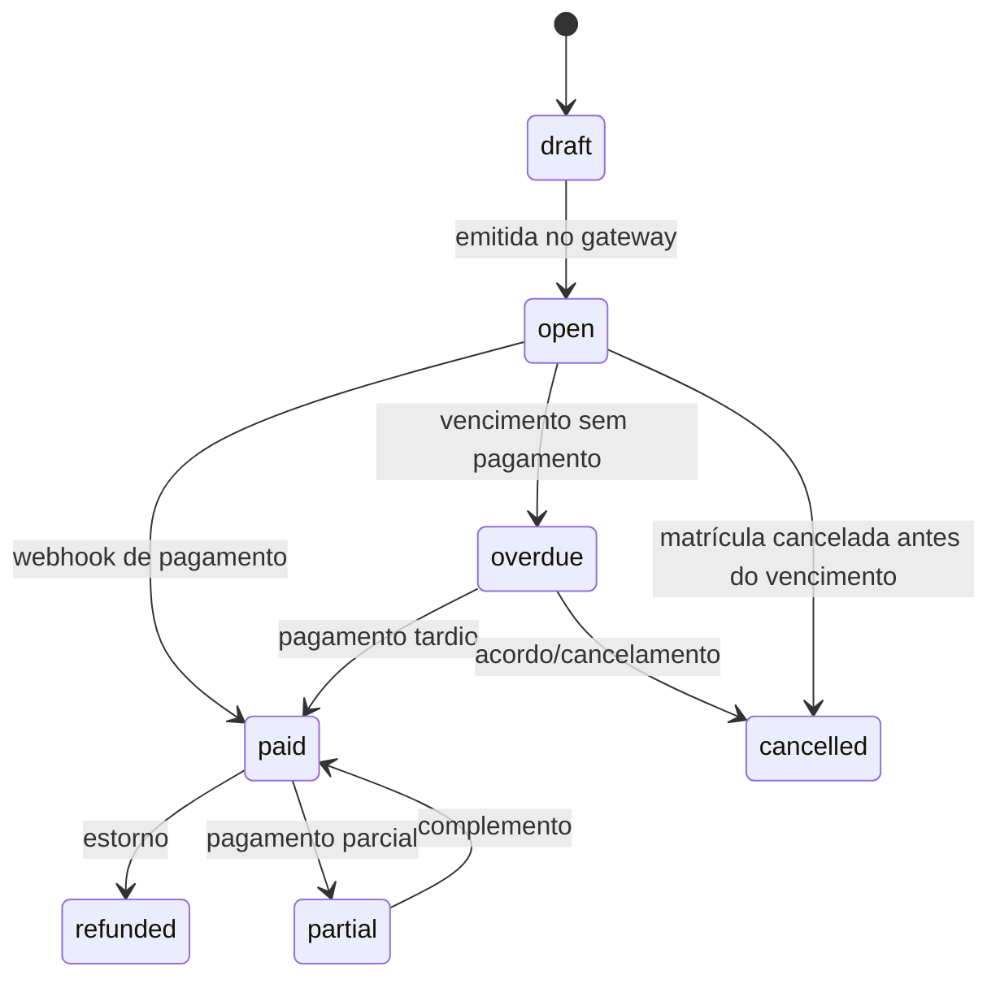

# 07 — Módulo financeiro

## 1. Princípio: o dinheiro é da escola

A NextGen **não** deve receber a mensalidade e repassar. Isso transformaria a empresa em
arranjo de pagamento, com obrigações regulatórias (BCB), risco de crédito e complexidade
contábil.

Duas arquiteturas possíveis:

| Modelo | Como funciona | Prós | Contras | Recomendação |
|---|---|---|---|---|
| **A. Conta própria da escola** | Escola conecta a própria conta Asaas/Iugu; a NextGen apenas orquestra via API | simples, sem risco regulatório, dinheiro cai direto na escola | onboarding exige a escola criar conta no gateway | ✅ **v1** |
| **B. Subconta + split** | NextGen cria subconta para a escola e faz split | experiência mais fluida | exige aprovação do gateway, KYC, suporte | v2 |

**Fallback para escolas sem gateway:** gerar **Pix copia-e-cola estático** + baixa manual +
upload de comprovante. Ainda resolve 80% da dor.

## 2. Ciclo de vida da cobrança



| Status | Significado | Ações |
|---|---|---|
| `draft` | gerada, ainda não enviada | editar, excluir |
| `open` | boleto/Pix emitido, dentro do prazo | reenviar, cancelar |
| `overdue` | venceu sem pagamento | cobrar, negociar, bloquear |
| `paid` | pago e conciliado | recibo, estorno |
| `partial` | pagamento menor que o total | complemento |
| `cancelled` | cancelada | registrar motivo |
| `refunded` | devolvida | registrar motivo |

## 3. Geração mensal

```
para cada enrollment ativa:
  se mês da competência está dentro da vigência:
    valor = plan.amount_cents
    valor -= desconto (bolsa, irmão, promoção)
    se primeiro mês e início no meio do ciclo:
      valor = pro_rata(dias_utilizados, dias_do_mes)
    cria charge com vencimento = dia configurado (ajustado para dia útil)
    enfileira emissão no gateway
    enfileira e-mail + WhatsApp para o responsável financeiro
```

**Regras**
- Competência é sempre o mês do serviço, não o mês do pagamento.
- Vencimento em fim de semana/feriado → próximo dia útil (configurável).
- Geração idempotente: chave `(enrollment_id, competencia)` única. Rodar o job duas vezes
  não duplica cobrança.
- Matrícula criada no dia 20 com vencimento dia 5 → primeira cobrança pro-rata + próxima cheia.
- Bolsa 100% gera `charge` de valor zero apenas para registro? **Não** — gera `invoice`
  sem cobrança, para não poluir inadimplência.
- Aluno `trial`, `pending_guardian` ou `cancelled` não gera cobrança.

## 4. Pro-rata, descontos e reajuste

| Caso | Regra |
|---|---|
| Entrada no meio do mês | `valor × dias_restantes / dias_do_mês`, arredondado para cima em centavos |
| Saída no meio do mês | cobrança cheia se após o dia 15; proporcional se antes (configurável) |
| Desconto percentual | aplicado sobre o valor do plano |
| Desconto fixo | aplicado após o percentual |
| Bolsa | desconto de 100%, com tipo próprio para relatório |
| Plano família | desconto por aluno adicional, a partir do 2º |
| Reajuste anual | aplica a partir da competência definida; cobranças já emitidas não mudam |
| Mudança de plano | ajuste proporcional na competência seguinte, com registro do motivo |

Tudo em **centavos inteiros**. Nunca `float`. Arredondamento documentado em `packages/core/money`.

## 5. Meios de pagamento

| Meio | Uso | Observações |
|---|---|---|
| **Pix** | padrão no Brasil | confirmação rápida; cobrar por QR dinâmico com expiração |
| **Boleto** | quem ainda usa | registro no banco, prazo D+1 a D+3; taxa por boleto |
| **Cartão recorrente** | famílias que preferem | reduz inadimplência, mas tem chargeback e taxa maior |
| **Dinheiro/transferência** | exceção | baixa manual com comprovante |

**Recomendação de produto:** oferecer Pix como default e cartão recorrente como opção
"não me preocupo mais". Boleto fica para quem exige.

## 6. Régua de cobrança

Configurável por escola, com templates aprovados:

| Momento | Canal | Mensagem |
|---|---|---|
| D-5 | e-mail | "Sua mensalidade vence em 5 dias" + link |
| D-1 | WhatsApp (opt-in) | lembrete curto |
| D0 | e-mail | "Vence hoje" |
| D+1 | e-mail | "Pagamento não identificado" + Pix |
| D+5 | WhatsApp | tom acolhedor, oferecer falar com a escola |
| D+10 | e-mail + telefone (tarefa) | risco de suspensão |
| D+20 | carta/contato | negociação |
| D+30 | decisão da escola | suspensão de acesso ao conteúdo (não à chamada) |

**Regras**
- Nunca cobrar o aluno; sempre o responsável financeiro.
- Nunca expor valor em notificação push (pode aparecer na tela de outra pessoa).
- Não enviar em domingo/feriado (configurável).
- Toda cobrança tem opt-out de lembrete, mas não de aviso de vencimento contratual.
- Suspensão por inadimplência: **não** impede o aluno de treinar (risco à criança e à imagem
  da escola). Bloquear apenas conteúdo digital e relatórios, e sempre com aviso prévio.

## 7. Inadimplência e negativação

- Painel com aging: 1–15, 16–30, 31–60, 61–90, 90+ dias.
- Total vencido, total a vencer, percentual sobre a receita do mês.
- Marcação de "em negociação" com promessa de pagamento e data.
- **Negativação (Serasa/Sispc)**: só após régua completa, com contrato que preveja, e
  **nunca** em nome do menor. Exige integração específica e é v2.
- Acordo: parcelamento com geração de novas cobranças e baixa da original como `cancelled`.

## 8. Despesas e resultado

- Categorias: salários, aluguel, energia, material esportivo, arbitragem, manutenção,
  marketing, impostos, software.
- Centro de custo por unidade.
- Despesa recorrente com dia de vencimento e alerta.
- Anexo de comprovante (foto do recibo).
- Painel mensal:

```
Receita bruta           = cobranças pagas + recebidas no mês (regime de caixa)
(-) Impostos            = configurável (% ou valor)
(-) Despesas            = pagas no mês
(=) Resultado do mês

Receita prevista        = cobranças em aberto + pagas
Inadimplência           = vencido / (vencido + pago)
Ticket médio            = receita / alunos ativos
```

**Dois regimes:** caixa (o que entrou) e competência (o que foi faturado). O padrão do
painel é caixa; o contador quer competência. Mostrar os dois com rótulo claro.

## 9. Conciliação

1. Webhook do gateway grava evento bruto (`webhook_events`) com idempotência.
2. Processa: localiza `charge` por `external_id`, registra `payment`, muda status.
3. Job diário baixa extrato do gateway e compara com o banco.
4. Divergências vão para uma fila de revisão manual com diff visível.
5. Baixa manual exige permissão `financeiro` e comprovante.

**Casos de borda**
- Pagamento duplicado → segunda entrada vira `payment` com flag `duplicate`, não baixa duas vezes.
- Pagamento de valor menor → `partial`, cobrança permanece aberta.
- Pagamento de aluno cancelado → estorno ou crédito, com decisão manual.
- Boleto vencido pago no banco → conciliação por valor + documento.
- Estorno após mês fechado → ajuste no mês corrente, com nota no histórico (não reescrever o passado).

## 10. Recibos e documentos

- Recibo em PDF com logo da escola, número sequencial por escola, dados do pagador.
- Envio automático ao responsável financeiro no pagamento.
- Armazenamento por 5 anos (guarda fiscal).
- Preparado para emissão de NFS-e no futuro (integração municipal é fragmentada no Brasil).

## 11. Painel financeiro (o que o dono vê)

**Topo:** recebido no mês · a receber · vencido · saldo projetado.

**Gráficos:** receita por mês (12 meses) · inadimplência (%) · despesas por categoria.

**Listas:** próximos vencimentos · inadimplentes · últimas baixas · despesas do mês.

**Filtros:** unidade, categoria, turma, plano, período.

**Exportação:** CSV e PDF; agendamento por e-mail (v1.1).

## 12. Regras de segurança e LGPD no financeiro

- Dados bancários e API keys criptografados por tenant.
- CPF do responsável mascarado na interface (`***.***.123-45`).
- Nenhum dado de cartão trafega ou é armazenado pela NextGen — tokenização no gateway.
- Acesso ao financeiro é separado do acesso pedagógico (`role = finance`).
- Log de toda alteração de valor, desconto e baixa manual (quem, quando, antes/depois).
- Exportação de inadimplentes é dado pessoal: exige permissão e gera auditoria.

## 13. Métricas do módulo

- Inadimplência (%) por mês
- Tempo médio de recebimento (D+?)
- Taxa de sucesso do Pix vs boleto
- Custo por cobrança emitida
- Recuperação pela régua (% de pagamentos após D+1)
- Receita por aluno (ARPU) e por turma

## 14. O que já está implementado (v0)

Sem gateway: o dinheiro cai direto na conta da escola via **Pix copia-e-cola** (BR Code EMV
montado em `packages/core/src/pix.ts`), e a baixa é manual. É o mínimo que resolve a dor sem
virar arranjo de pagamento.

**Modelo.** `TuitionPlan` (valor mensal + dia de vencimento), `Student.tuitionPlanId` e
`Enrollment.discountCents/dueDay`, `Invoice` (competência `YYYY-MM`, `amount`, `paidCents`,
`status`, `dueDate`, `cancelReason`), `InvoicePayment` (valor, forma, data, quem registrou),
`Expense` (categoria, valor, vencimento, pago em) e `AuditLog` com `before`/`after` em JSON.

**Regras em `@nextgen/core`:**
- `monthlyCharge` = plano − desconto, com rateio proporcional no primeiro mês (`prorateMonthly`);
- vencimento no dia combinado, ajustado para o último dia do mês quando não existe (31 em fevereiro);
- `isOverdue` compara **dia** em UTC: vencimento no próprio dia ainda não é atraso;
- `chargeState` distingue `aberta`, `vencida`, `paga` (inclusive parcial) e `cancelada`;
- `delinquentStudents` agrupa por aluno, com dias de atraso da cobrança mais antiga;
- `normalizePixKey` (CPF/CNPJ sem pontuação, telefone com `+55`, e-mail e chave aleatória) e
  `pixPayload` com valor, txid da cobrança e texto sem acento.

**Na tela.** `/financeiro` mostra recebido, a receber, vencido, despesas, saldo, inadimplentes,
a lista da competência, planos, chave Pix e despesas do mês. Ações: gerar a competência
(idempotente por `(studentId, competence)`), registrar pagamento total ou parcial, cancelar
cobrança, copiar Pix, enviar por e-mail e marcar despesa como paga. `/meus-boletos` é a visão
do responsável, limitada aos alunos sob sua guarda.

**Isolamento.** Toda query passa por `withTenant`; a escola vem de `app.current_school_id`,
nunca do formulário. O responsável não entra em `/financeiro` — `charge:read` vale para ele
apenas no âmbito dos próprios filhos.

**O que falta para produção:** gateway (Asaas/Iugu) com webhook e conciliação, boleto
registrado, e-mail automático da régua, recibo em PDF, NFS-e, aging 16–90 dias e exportação.
