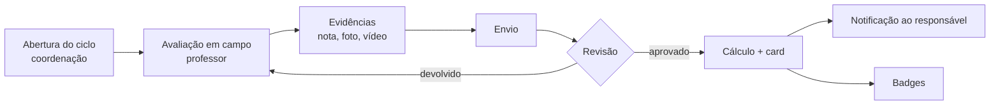

# 08 — Avaliação de habilidades e card do aluno

## 1. O problema de avaliar criança

Um card com nota é motivador para uns e cruel para outros. Se a escola publica ranking,
cria conflito entre pais, compara crianças de corpos e maturidades diferentes e expõe dados
de menor. O produto precisa equilibrar três coisas:

1. **Feedback útil** para o professor e a família.
2. **Motivação saudável** para o aluno.
3. **Conformidade e discrição** — nada público sem consentimento.

Decisão de produto:

> O card é uma ferramenta de **evolução pessoal**, não de comparação. Não existe ranking
> público. Não existe "peneira" visível. Não existe nota de comportamento no card público.

## 2. Modelo de habilidades

Quatro pilares, 16 atributos. Cada escola pode editar nomes e pesos, mas o default é:

### Técnico
| Código | Atributo | O que mede |
|---|---|---|
| `CTL` | Controle | domínio, primeiro toque, condução |
| `PAS` | Passe | precisão, visão de passe curto |
| `FIN` | Finalização | chute, pontaria, decisão |
| `DRI` | Drible | mudança de direção, 1x1 |

### Físico
| Código | Atributo | O que mede |
|---|---|---|
| `VEL` | Velocidade | aceleração e velocidade máxima |
| `AGI` | Agilidade | mudança de direção, coordenação |
| `RES` | Resistência | fôlego em jogo e treino |
| `FOR` | Força | estabilidade, disputa corporal adequada à idade |

### Tático
| Código | Atributo | O que mede |
|---|---|---|
| `POS` | Posicionamento | ocupar espaço, noção de zona |
| `DEF` | Marcação | pressão, cobertura, recuperação |
| `VIS` | Leitura de jogo | reconhecer superioridade, tempo de passe |
| `MOV` | Movimentação | desmarcação, amplitude, profundidade |

### Comportamental (interno)
| Código | Atributo | O que mede |
|---|---|---|
| `DIS` | Disciplina | assiduidade, atenção às instruções |
| `EQU` | Trabalho em equipe | cooperação, atitude com colegas |
| `RESI` | Resiliência | reação a erro e derrota |
| `FOC` | Foco | concentração na atividade |

> **Comportamental é sempre privado.** Aparece para coordenação, professor e responsável.
> Nunca no card público, nunca no ranking, nunca em material de marketing.

## 3. Escala e rubrica

Escala de 1 a 5, com descritor observável. Sem nota fracionária — força o professor a
decidir e reduz falsa precisão.

| Nota | Nome | Descritor |
|---|---|---|
| 1 | Iniciando | executa com apoio constante, ainda não entende o objetivo |
| 2 | Em desenvolvimento | executa em situação simples, com ajuda |
| 3 | Consolidando | executa sozinho em treino, oscila em jogo |
| 4 | Aplicando | executa com consistência em treino e jogo |
| 5 | Referência da faixa | executa com autonomia e ajuda os colegas |

**Regras de avaliação**
- Toda nota 1 ou 5 exige comentário (evita extremos impulsivos).
- O professor avalia **apenas** as skills que trabalhou no ciclo; o resto fica "não avaliado".
- Comparação é sempre do aluno com ele mesmo (delta), nunca com a turma.
- Duas avaliações no mesmo ciclo exigem justificativa e geram versão.
- Avaliação aprovada é imutável.

## 4. Ciclo de avaliação



- Frequência padrão: **trimestral** (configurável por escola).
- Ciclo tem janela de avaliação e de revisão.
- Relatório de adesão: quantos alunos da turma foram avaliados (meta ≥ 95%).

## 5. Cálculo do "overall"

Dois números diferentes, com propósitos diferentes:

**1. `development_index` (0–100)** — índice interno de evolução, usado em relatório:

```
média_ponderada = Σ(score_i × peso_i) / Σ(peso_i)     // escala 1–5
development_index = ((média_ponderada - 1) / 4) × 100
```

**2. `card_rating` (estilo FIFA)** — só para o card, escalado por faixa etária:

```
base = 40
card_rating = round(base + (média_ponderada - 1) × 15)   // 40 a 100
```

Ajuste por posição (pesos diferentes por função):

| Perfil | Pesos maiores |
|---|---|
| Goleiro | DEF, POS, AGI, FOC |
| Zagueiro | DEF, POS, FOR, DIS |
| Lateral | VEL, RES, DEF, MOV |
| Meio-campo | PAS, VIS, CTL, RES |
| Atacante | FIN, DRI, VEL, MOV |

**Nunca** exibir `card_rating` para menor de 12 — exibir barras de progresso e badges.
Para 12+, exibir apenas no card privado e, se autorizado, no público.

> Um "OVR 62" para uma criança de 9 anos é ficção estatística e vira competição entre pais.
> O número é útil para o adolescente se sentir progredindo; para a criança, a barra enche.

## 6. Card: especificação visual

Inspiração em card de jogo, mas com identidade própria da escola.

```
┌──────────────────────────────────────┐
│  [logo]  SUB-9 · 2027        [badge] │
│                                      │
│   ┌────────┐      APELIDO            │
│   │  FOTO  │      "PEDRINHO"         │
│   │        │      Atacante · #9      │
│   └────────┘      ⚡ 7 badges         │
│                                      │
│   TÉC  ████████░░  78                │
│   FÍS  ██████░░░░  65                │
│   TÁT  █████░░░░░  58                │
│                                      │
│   CTL 72  PAS 65  FIN 80  DRI 74     │
│   VEL 70  AGI 66  RES 55  FOR 48     │
│                                      │
│   ↑ +6 desde o último ciclo          │
└──────────────────────────────────────┘
```

**Regras de design**
- Cor de destaque = paleta da escola.
- Foto: proporção 1:1, fundo neutro, sem dados pessoais na imagem.
- `nickname` é o padrão; nome completo só com consentimento explícito.
- Sem data de nascimento. A turma e a idade substituem a categoria.
- Card público **só existe a partir dos 12 anos**, com consentimento do responsável; abaixo
  disso o card é privado (portal e painel), nunca publicado.
- Sem telefone, endereço, horário de treino.
- Rodapé com selo "perfil autorizado pelo responsável" e data da autorização.
- Versão privada (portal) mostra histórico e detalhamento por skill.
- Exportação como imagem (1080×1350) com marca d'água discreta.

## 7. Badges e engajamento

Badges por **comportamento e evolução**, não por "ser melhor que o outro":

| Badge | Critério |
|---|---|
| Primeiro Treino | primeira presença |
| Presença de Ouro | 90% de presença no mês |
| Evolução Constante | +2 em qualquer skill no ciclo |
| Trabalho em Equipe | destaque em EQU (avaliação do professor) |
| Superação | retorno após lesão/afastamento |
| Explorador | concluiu 5 conteúdos |
| Fair Play | registro de atitude positiva em jogo |

**Proibido:** loot box, compra de pacote, ranking, "carta lendária" paga, aposta. Além de
ser antiético com criança, o ECA Digital veda mecânicas de recompensa paga para menores
(art. 20).

## 8. Privacidade do card

| Idade | Card público | Nome | Foto | Skills numéricas | Badges |
|---|---|---|---|---|---|
| < 12 | opt-in, default off | apelido | ❌ | ❌ (só barras) | ✅ |
| 12–15 | opt-in | nome **ou** apelido | opt-in separado | ✅ se autorizado | ✅ |
| 16–17 | opt-in + co-assentimento | ✅ | ✅ | ✅ | ✅ |
| 18+ | decisão do aluno | ✅ | ✅ | ✅ | ✅ |

- `noindex, nofollow` por padrão.
- Slug aleatório de 22 caracteres (`/p/7fK2...`), não sequencial.
- Cache invalidado por tag ao revogar.
- Botão "solicitar remoção" no rodapé.
- Nenhum dado do card entra em sitemap ou busca interna.

## 9. Dados e API

```
GET /api/students/:id/card            (privado, autenticado)
GET /p/:slug                          (público, sem dados sensíveis)
POST /api/assessments                 (professor)
POST /api/assessments/:id/submit
POST /api/assessments/:id/approve     (coordenação)
POST /api/students/:id/card/consent   (responsável)
```

Payload público do card:

```json
{
  "slug": "7fK2...",
  "nickname": "Pedrinho",
  "category": "Sub-9",
  "position": "Atacante",
  "jersey": 9,
  "badges": ["primeiro_treino", "presenca_ouro"],
  "pillars": { "technical": 78, "physical": 65, "tactical": 58 },
  "trend": 6,
  "authorized_by": "guardian",
  "authorized_at": "2026-11-01"
}
```

O endpoint público **não** consulta nome completo, foto, escola ou comportamento — a query
já nasce restrita, não é filtro de resposta.

## 10. Relatórios pedagógicos

- Evolução por aluno (linha do tempo de skills).
- Evolução por turma (média e dispersão — visão interna).
- Alunos sem avaliação no ciclo.
- Skills com pior evolução na turma (insumo para o plano de aula).
- Comparativo ciclo × ciclo (mesmo aluno).
- PDF "boletim do atleta" para entregar ao responsável, com marca da escola.

## 11. Erros a evitar

1. Nota única de "potencial" ou "nota do olheiro".
2. Ranking entre crianças.
3. Avaliar sem ter visto o aluno (nota herdada do ciclo anterior).
4. Comportamento no card público.
5. Card com nome completo, foto e escola para menor de 12.
6. Badge comprável.
7. Gráfico de evolução que começa em zero (engana o responsável).
8. Média da turma exposta ao responsável (compara crianças indiretamente).
