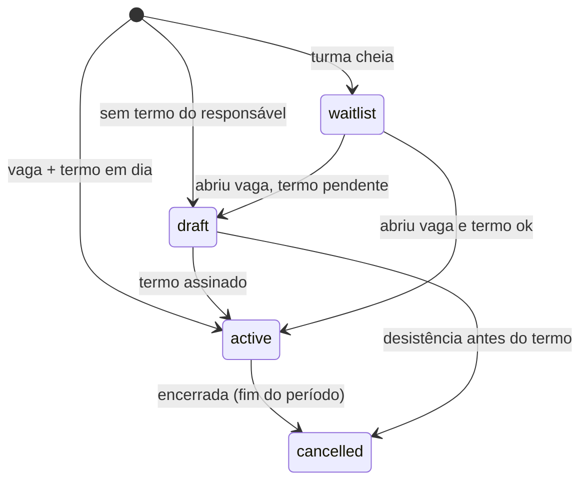

# 17 — Turmas e matrícula (fase 1, primeira entrega)

Este documento registra o que foi construído em `/turmas`, por que cada regra existe e o que
ficou de fora. Complementa o modelo de dados ([05](05-modelo-dados.md)) e a fase 1 do
[roadmap](09-roadmap.md); não repete o que já está lá.

## 1. A hierarquia

```
season (temporada)
└── category (Sub-8, Sub-9…)   faixa de ano de nascimento
    └── class_group (turma)    dias, horário, unidade, sala, capacidade
        └── enrollment         aluno × turma × situação
```

Cada nível tem um motivo:

| Nível | Por que separado |
|---|---|
| **temporada** | a escola reabre categorias todo ano; trocar de temporada arquiva a anterior sem apagar matrícula nem histórico |
| **categoria** | é a regra de idade, escrita uma vez. A faixa (`birth_year_from`/`birth_year_to`) decide quem pode entrar na turma |
| **turma** | mesmo Sub-8 tem terça/quinta 17h e sábado 9h. A vaga, o professor e a sala são da turma, não da categoria |
| **matrícula** | o vínculo do aluno com a turma **naquele período**. Encerrar não apaga: preenche `ends_on` |

Sub-8 na temporada 2026 = nascidos em 2018 (`suggestBirthYearRange` em `packages/core`). Categoria
de dois anos (Sub-11 = 2015 e 2016) é permitida preenchendo os anos na mão — comum em escolinha
que junta duas idades por falta de turma.

## 2. Situações da matrícula



- **rascunho** existe porque a secretaria matricula antes de o responsável assinar. Nada é
  liberado ao responsável e o aluno **não ocupa vaga**.
- **lista de espera** guarda a ordem de chegada (`waitlist_position`). Chamar exige vaga livre.
- **cancelada** mantém `starts_on`/`ends_on`: o histórico de quem esteve na turma é dado
  pedagógico e financeiro.

## 3. A ordem das checagens (e por que essa ordem)

`decideEnrollment` (`packages/core/src/class-group.ts`) é pura e testada; a action só consulta o
banco e obedece. A ordem importa:

| # | Checagem | Resultado | Por que antes das outras |
|---|---|---|---|
| 1 | já existe matrícula na turma | bloqueia | evita duplicar aluno na chamada |
| 2 | consentimento **revogado** | bloqueia | revogação é ato do responsável; nada a contorna |
| 3 | categoria incompatível | bloqueia (com exceção) | é a regra mais visível para a escola |
| 4 | outra turma ativa na temporada | bloqueia (com exceção) | evita cobrança dupla e duas chamadas |
| 5 | turma lotada | lista de espera | lotação **não** é bloqueio; é fila |
| 6 | consentimento ausente | rascunho | a vaga já foi decidida; falta o termo |

Duas consequências deliberadas:

- **Lotação vence termo pendente.** Sem vaga, não há o que ativar depois: o lugar é da fila.
- **Revogação vence tudo.** Quem revogou não entra nem na fila.

## 4. Exceção com motivo, nunca silenciosa

Categoria e "uma turma por temporada" aceitam exceção — atleta de 2009 que joga no Sub-13,
aluno que treina em duas turmas. A exceção exige texto em `override_reason` (≥ 10 caracteres),
vai para `audit_log` e aparece na linha da turma.

**Exceção não fura lotação.** Quem autoriza a idade não compra vaga: se a turma está cheia, a
matrícula com exceção entra na fila como qualquer outra. O primeiro código desta entrega fazia
o contrário; o teste de UI mostrou a turma passando de 1/1 para 2/1.

Consentimento revogado, duplicidade e dados inválidos **não** têm exceção — não é decisão da
escola.

## 5. O que a tela mostra

`/turmas` — temporada ativa, categorias com contagem, tabela de turmas com ocupação e professor.
Formulários em `<details>`: "Nova categoria", "Abrir turma", "Trocar de temporada".

`/turmas/[id]` — cabeçalho da turma, três números (matriculados, vagas, lista de espera), painel
de professores, matrícula e a lista da turma com consentimento por aluno.

Regras de acabamento aplicadas ([16](16-padroes-de-acabamento.md)):

- **vazio** diz o próximo passo ("Cadastre uma unidade antes de abrir turma");
- **erro** diz a correção ("Choque de horário com Sub-9 — Sáb 9h. Troque o horário ou a sala");
- **sem permissão** explica e oferece caminho, em vez de 404;
- ação que remove a própria linha avisa por `?aviso=`, porque o componente que mostraria o
  resultado desaparece junto com a linha;
- tabela rola dentro do card no celular (`.table-scroll`): esconder coluna no mobile é perder
  dado de aluno.

## 6. Permissões

| Papel | Vê | Cria/edita |
|---|---|---|
| admin | todas as turmas | temporada, categoria, turma, matrícula, professor |
| coordenação | todas as turmas | turma, matrícula |
| professor | **só as turmas dele** | nada (leitura) |
| responsável | nada em `/turmas` | — |

O filtro do professor é explícito no `where` (`teachers: { some: { userId } }`); a RLS isola a
escola, não o papel. O responsável é barrado na página, com mensagem: a RLS escolar não impede
que ele leia a turma inteira, e turma inteira é nome de outras crianças.

## 7. Auditoria

Toda escrita grava `audit_log`: `season.create`, `category.create`, `class_group.create`,
`enrollment.create`, `enrollment.end`, `enrollment.activate`, `class_group.teacher.assign`,
`class_group.teacher.remove` — com `before`/`after` e o motivo da exceção quando houver.

## 8. Fora desta entrega

- Chamada e reposição de aula (depende da turma, entra na sequência).
- Plano de aula por turma.
- Cobrança da matrícula (a competência nasce daqui, mas o financeiro é o próximo bloco).
- Conflito de **professor** em duas turmas no mesmo horário — hoje só checamos sala.
- Transferência de turma com histórico (hoje: encerra e matricula de novo).
- Edição e arquivamento de turma pela tela (o modelo já tem `is_active` e `deleted_at`).
